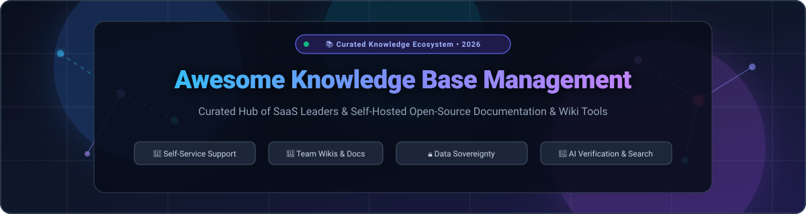

  

  
  
  
  
  
  
  

---

# 📚 Awesome Knowledge Base Management

> **A comprehensive, SEO-optimized directory of category-leading SaaS platforms and open-source GitHub projects for Knowledge Base Management Systems (KBMS), internal team wikis, self-service customer support portals, engineering runbooks, and structured documentation ecosystems.**

Knowledge base management software empowers modern teams to centralize institutional memory, automate customer deflection, coordinate asynchronous engineering operations, and provide verified information retrieval across distributed workforces.

---

## 📑 Table of Contents

- [📊 Sector Overview & Market Dynamics](#-sector-overview--market-dynamics)
- [☁️ SaaS & Hosted Knowledge Base Platforms](#️-saas--hosted-knowledge-base-platforms)
- [💻 Open-Source Knowledge Base & Wiki Projects](#-open-source-knowledge-base--wiki-projects)
- [🧭 Architecture & Selection Matrix](#-architecture--selection-matrix)
- [🤝 How to Contribute](#-how-to-contribute)
- [⭐ Star History](#-star-history)
- [💖 Support & Sponsoring](#-support--sponsoring)
- [⚖️ Disclaimer & License](#️-disclaimer--license)

---

## 📊 Sector Overview & Market Dynamics

- **Estimated Market Size & Growth**: The global Knowledge Management Software market was valued at **~$19.5 Billion in 2024** and is projected to surpass **~$42.8 Billion by 2032**, demonstrating a compound annual growth rate (**CAGR of ~11.8%**). This acceleration is driven by enterprise generative AI integration (RAG and LLM grounding), remote/hybrid workforce documentation needs, and an urgent mandate for customer support ticket deflection.
- **Market Structure & Fragmentation**: The sector is **moderately fragmented** rather than a winner-take-all monopoly. While enterprise tech titans (Salesforce, Atlassian, Zendesk) dominate high-ACV corporate contracts and support service desks, high-velocity agile SaaS providers (Notion, GitBook, Guru) and robust self-hosted open-source platforms (AppFlowy, AFFiNE, Docusaurus, Outline, BookStack) command strong adoption among engineering teams, fast-growing startups, and privacy-conscious organizations demanding data sovereignty and zero seat-tax licensing.

---

## ☁️ SaaS & Hosted Knowledge Base Platforms

The table below compiles industry-leading SaaS solutions, sorted in descending order by **Company Scale (Valuation / Annual Revenue)**.

| Platform & Vendor | Primary Category & Key Features | Company Scale (Valuation / Revenue) 🔽 | Starting Tier Pricing | Free Forever Tier / Free Trial Limits |
| :--- | :--- | :--- | :--- | :--- |
| **[Salesforce Knowledge](https://www.salesforce.com/)** | Enterprise CRM Knowledge Base, case deflection, multi-lingual authoring, Agentforce AI integration | **~$34.9B ARR / ~$280B Market Cap** | **$25 / user / month** (Service Cloud Starter Suite, billed annually) | **30-day free trial** (Full Service Cloud access for up to 10 users, pre-built service workflows; no credit card required; no permanent free tier) |
| **[Confluence](https://www.atlassian.com/software/confluence)** (Atlassian) | Enterprise team workspace, collaborative wiki, Jira workflow integration, Atlassian Intelligence | **~$4.3B Revenue / ~$45B Market Cap** | **$6.05 / user / month** (Standard plan, billed annually) | **Free forever plan** (Up to 10 users, 2 GB total file storage, unlimited spaces and pages, community support; 14-day free trial for Standard/Premium) |
| **[Zendesk Guide](https://www.zendesk.com/)** | Customer support help center, knowledge base, multi-brand self-service portal, Answer Bot | **$10.2B Private Valuation / ~$1.7B ARR** | **$19 / agent / month** (Support Team tier, billed annually) | **14-day free trial** (Full Zendesk Suite capabilities unlocked, sample data, multi-channel support; no credit card required; no permanent free tier) |
| **[Notion Enterprise](https://www.notion.com/)** | All-in-one connected workspace, modular docs, relational databases, team wikis, Notion AI | **$10.0B Valuation / ~$250M ARR** | **$10 / user / month** ($8 / user / mo billed annually for Plus plan) | **Free forever plan** (Unlimited pages & blocks for individuals, up to 10 guest collaborators, 5 MB file upload cap; 1,000-block trial for teams) |
| **[Freshdesk Solutions](https://www.freshworks.com/freshdesk/)** (Freshworks) | Omnichannel service desk, public help center, article lifecycle management, Freddy AI bot | **~$700M ARR / ~$3.5B Market Cap** | **$15 / agent / month** (Growth tier, billed annually) | **Free forever plan** (Up to 10 agents, includes public & internal knowledge base, ticket management; 14-day free trial for paid tiers) |
| **[Guru](https://www.getguru.com/)** | AI-powered enterprise search & wiki, verification workflows, browser extension, Slack/Teams bots | **~$600M Valuation / ~$30M ARR** | **$10 / user / month** (Builder tier, billed annually) | **30-day free trial** (Full AI search, automated verification workflows, browser extension, unlimited knowledge cards; no permanent free tier) |
| **[GitBook](https://www.gitbook.com/)** | Developer-centric technical documentation, Git/GitHub two-way synchronization, markdown native | **~$300M Valuation / ~$15M ARR** | **$6.70 / user / month** (Plus tier, billed annually; $14 / user / mo monthly) | **Free forever plan** (1 public documentation site for individual technical writers & open-source projects, unlimited docs, Git sync; 14-day trial on Plus) |
| **[Document360](https://document360.com/)** (Kovai.co) | Purpose-built product knowledge base, private/public portals, version control, API documentation | **~$100M Valuation / ~$18M ARR** | **$149 / project / month** (Standard plan, includes 3 team seats, billed annually) | **Free forever plan** (Up to 50 articles, 1 team account, 1 public knowledge base, 1 GB storage, Document360 branding; 14-day full-feature trial) |
| **[Helpjuice](https://helpjuice.com/)** | High-customization standalone knowledge base software, advanced search analytics, AI answers | **~$30M Valuation / ~$8M ARR** (Bootstrapped) | **$120 / month** (Starter plan flat rate for up to 4 users, all core features included) | **14-day free trial** (Unlimited features, AI search, analytics, and complimentary expert theme design customization; no permanent free tier) |
| **[Slite](https://slite.com/)** | Clean collaborative team wiki, AI-assisted information retrieval, structured handbook collections | **~$25M Valuation / ~$4M ARR** | **$8 / user / month** (Standard plan, billed annually; $10 / user / mo monthly) | **Free forever plan** (Up to 50 collaborative docs, unlimited team members, 10 AI questions trial; 14-day free trial for Standard plan) |

---

## 💻 Open-Source Knowledge Base & Wiki Projects

Every project below is 100% open-source or source-available for self-hosting. Sorted in descending order by **GitHub Stars_Count** with direct links to repo stargazers.

- **[AppFlowy](https://github.com/AppFlowy-IO/AppFlowy)**   
  *Open-source, local-first alternative to Notion.* Built with Flutter and Rust, offering modular documents, relational databases, Kanban boards, and customizable AI assistance with complete data ownership. AGPL-3.0 licensed.

- **[AFFiNE](https://github.com/toeverything/AFFiNE)**   
  *Next-gen all-in-one workspace uniting docs, whiteboard, and databases.* Combines a Notion-like text editor with a Miro-like infinite canvas, privacy-first local storage, and real-time multiplayer synchronization. MIT licensed.

- **[Docusaurus](https://github.com/facebook/docusaurus)**   
  *Modern React-powered static documentation site generator from Meta.* Supports MDX (React components in Markdown), multi-language localization (i18n), semantic doc versioning, and Algolia/Typesense search integration. MIT licensed.

- **[Memos](https://github.com/usememos/memos)**   
  *Privacy-first, ultra-lightweight knowledge sharing and micro-blogging service.* Uses Go and SQLite/PostgreSQL to deliver instant Markdown notes, tag-based taxonomy, REST APIs, and self-hosted team micro-knowledge bases. MIT licensed.

- **[Joplin](https://github.com/laurent22/joplin)**   
  *Secure, end-to-end encrypted note-taking and knowledge organizer.* Handles large notebook hierarchies, Markdown notes with multimedia attachments, terminal/GUI clients, web clipping, and sync via Nextcloud/Dropbox/WebDAV. AGPL-3.0 licensed.

- **[Logseq](https://github.com/logseq/logseq)**   
  *Privacy-first, local-first outliner and bidirectional knowledge graph platform.* Operates directly on plain-text Markdown and Org-mode files on disk, supporting flashcards, PDF annotations, queries, and graph visualizations. AGPL-3.0 licensed.

- **[Outline](https://github.com/outline/outline)**   
  *Blazing-fast, modern collaborative team knowledge base and wiki.* Features a polished block-based editor, slash commands, file attachments, backlinks, full-text search, and SSO/OIDC integration. Built on Node.js, React, and PostgreSQL. BSL 1.1 licensed.

- **[Slate](https://github.com/slatedocs/slate)**   
  *Beautiful, three-panel responsive static documentation generator for APIs.* Inspired by Stripe's renowned API docs, allowing multi-language code samples, Markdown authoring, and smooth scrolling without complex dependencies. Apache-2.0 licensed.

- **[Docsify](https://github.com/docsifyjs/docsify)**   
  *Magical client-side documentation site generator without a build step.* Renders Markdown files on-the-fly directly in the browser. Lightweight, zero compilation delays, with rich plugin ecosystem and multi-theme support. MIT licensed.

- **[Wiki.js](https://github.com/requarks/wiki)**   
  *Extensible, modern open-source wiki software built on Node.js.* Supports visual WYSIWYG, Markdown, and AsciiDoc editors, Git-backed synchronization, granular role permissions, and pluggable auth (LDAP, SAML, OIDC). AGPL-3.0 licensed.

- **[MkDocs](https://github.com/mkdocs/mkdocs)**   
  *Fast, simple Python-based static site generator for project documentation.* Paired with the popular `mkdocs-material` theme, it features instant live-reload previewing, YAML configuration, search, and Markdown extension plugins. BSD-2-Clause licensed.

- **[mdBook](https://github.com/rust-lang/mdBook)**   
  *Command-line tool to create online books and documentation from Markdown files.* Written in Rust for speed, it powers the official Rust documentation, offering search, print styling, and custom preprocessors. MPL-2.0 licensed.

- **[Docmost](https://github.com/docmost/docmost)**   
  *Open-source collaborative wiki and documentation platform.* A self-hosted alternative to Confluence and Notion, featuring real-time multiplayer editing, nested document trees, spaces, file management, and role permissions. AGPL-3.0 licensed.

- **[BookStack](https://github.com/BookStackApp/BookStack)**   
  *Opinionated, intuitive self-hosted documentation platform.* Organizes documentation into Shelves, Books, Chapters, and Pages. Built with PHP/Laravel and MySQL, offering WYSIWYG/Markdown modes, draw.io diagrams, revision history, and LDAP/SAML. MIT licensed.

- **[Foam](https://github.com/foambubble/foam)**   
  *Personal knowledge management and sharing system built on Visual Studio Code.* Inspired by Roam Research and Obsidian, utilizing plain Markdown files, bidirectional link graphs, and Git workflows. MIT licensed.

- **[Anytype](https://github.com/anyproto/anytype-ts)**   
  *Local-first, encrypted, decentralized P2P knowledge operating system.* Based on an object-oriented graph architecture where every document, task, and note is an interconnected object with zero-knowledge encryption. AGPL-3.0 licensed.

- **[HedgeDoc](https://github.com/hedgedoc/hedgedoc)**   
  *Real-time collaborative Markdown editor and note-taking platform.* Formerly CodiMD, featuring live side-by-side editing, slide presentations, diagram rendering (Mermaid, Graphviz, PlantUML), and granular permission controls. AGPL-3.0 licensed.

- **[SilverBullet](https://github.com/silverbulletmd/silverbullet)**   
  *Extensible, programmable, local-first personal knowledge base.* Stores all data as clean Markdown files, featuring an in-editor query language (Space Lua/Script), live templates, plug system, and offline-first PWA operation. MIT licensed.

- **[MediaWiki](https://github.com/wikimedia/mediawiki)**   
  *The enterprise-scale wiki engine powering Wikipedia.* Designed for massive institutional knowledge repositories with rich templating, category namespaces, comprehensive audit histories, and multilingual content management. GPL-2.0+ licensed.

- **[DokuWiki](https://github.com/dokuwiki/dokuwiki)**   
  *Lightweight, standards-compliant wiki that requires zero database setup.* Stores all content in plain text flat files, features built-in access control lists (ACLs), low hardware footprints, and hundreds of community plugins. GPL-2.0 licensed.

- **[TriliumNext](https://github.com/TriliumNext/Notes)**   
  *Hierarchical note-taking application designed for large personal knowledge bases.* Features arbitrarily deep tree structures, JavaScript note execution, automated note deduplication, encryption, and REST API access. AGPL-3.0 licensed.

- **[Sourcey](https://github.com/sourcey/sourcey)**   
  *High-precision developer documentation engine for APIs.* Ingests OpenAPI specs, MCP servers, and Markdown guides, generating static HTML documentation with interactive multi-language code samples and instant client-side search. AGPL-3.0 licensed.

- **[Tome](https://github.com/tomehq/tome)**   
  *Modern open-source documentation platform for developer tools.* Features AI search with Bring-Your-Own-Key (BYOK), MCP server integration for AI coding assistants, OpenAPI/TypeDoc generators, and Markdown/MDX workflows. MIT licensed.

---

## 🧭 Architecture & Selection Matrix

| Evaluation Dimension | Hosted SaaS Solutions | Self-Hosted Open-Source Platforms |
| :--- | :--- | :--- |
| **Data Privacy & Compliance** | Third-party cloud hosting; vendor SOC2/ISO27001 certifications. | **100% data sovereignty**; on-premises air-gapped or private cloud deployment (HIPAA/GDPR/ITAR friendly). |
| **Total Cost of Ownership (TCO)** | Per-seat monthly subscription costs that scale linearly with headcount ($6 to $165+/seat/month). | **Zero per-seat licensing fees**; costs restricted to bare-metal or cloud infrastructure compute & storage. |
| **Operational Maintenance** | Zero infrastructure maintenance; automated backups and security patches managed by vendor. | Requires in-house DevOps for container management, database backups, updates, and SSL/auth provisioning. |
| **Customizability & Extensibility** | Pre-built templates, API integrations, and vendor-curated marketplace apps. | **Full source code access**; custom themes, database triggers, internal plugins, and arbitrary data pipelines. |
| **Best-Fit Team Profile** | Customer service desks, non-technical operations teams, cross-department enterprise enterprises. | Developer tool teams, engineering runbook authors, security-conscious enterprises, local-first researchers. |

---

## 🤝 How to Contribute

Contributions from technical writers, open-source maintainers, and documentation leads are warmly welcomed!

1. 🍴 **Fork the Repository**: Create your personal branch (`git checkout -b feature/add-new-kb-tool`).
2. 📝 **Add/Update Entries**: Follow the formatting established in the tables and lists above.
   - For SaaS tools: include verified starting tier pricing, explicit free tier / free trial limits, and company scale metrics.
   - For Open-Source tools: include the social Stars_Badge linking to the stargazer page, tech stack, and license.
3. 🧪 **Check Consistency**: Ensure links are valid, descriptions remain objective and factual, and markdown formatting is intact.
4. 🚀 **Submit a Pull Request**: Provide a concise summary of additions or updates in your PR description.

---

## ⭐ Star History

---

## 💖 Support & Sponsoring

Thank you for visiting and using this curated directory! If this repository helped you find the right documentation engine or knowledge base architecture for your team, please consider supporting the project:

- ⭐ **Star this repository** to improve its visibility and help other developers and teams find it.
- 🍴 **Fork and contribute** new open-source gems, benchmarks, or updated pricing tiers.
- 📢 **Share with colleagues**, technical writers, and developer communities.
- ☕ **Sponsor the Maintainer**: Support ongoing curation, research, and open-source tooling directly on the [GitHub Sponsor Dashboard](https://github.com/sponsors/ishandutta2007).

---

## ⚖️ Disclaimer & License

- **Disclaimer**: This directory is community-curated for informational and comparative purposes only. Product features, pricing tiers, and licensing models are subject to change by their respective vendors and maintainers.
- **Data Compliance**: Organizations deploying knowledge management platforms must ensure compliance with applicable data protection regulations (GDPR, CCPA, HIPAA) and accessibility standards (WCAG).
- **License**: Released under the [MIT License](LICENSE).
